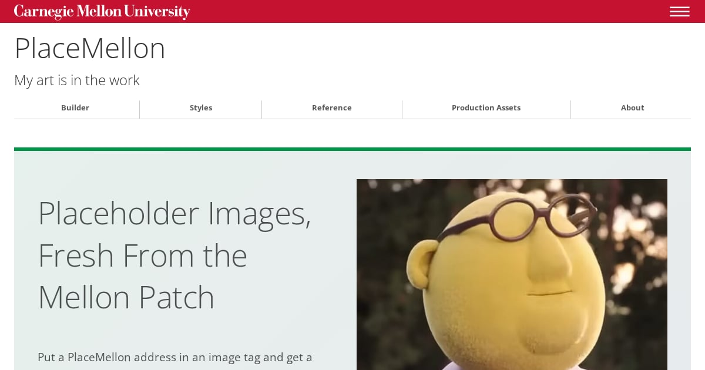

# PlaceMellon

PlaceMellon gives you placeholder images for Carnegie Mellon websites and
apps, at whatever size your layout calls for, from campus photos to Scotty
profile pictures and plain gray boxes.

Site: https://placemellon.andrew.cmu.edu/

## Use It

Put a width and height in the URL (e.g.,
`https://placemellon.andrew.cmu.edu/400/300`) and use it wherever you need
an image. Choose a category, make it grayscale or ask for a random photo.
The builder lets you preview the result and copy its URL or HTML. In Ruby
and Rails, the `cmu-web-placemellon` gem builds the same addresses; see
[its README](packages/ruby/README.md).

The photos come from CMU Selects. Use them for CMU mockups and prototypes;
for a finished page, download the photo from the source collection. The
[images and icons](https://placemellon.andrew.cmu.edu/assets.html), such as
the sample ID card, bio placeholder, default profile picture and question
mark, are fine on live sites. PlaceMellon was inspired by
[PlaceCats](https://www.placecats.com/) and
[PlaceBear](https://placebear.com/).

### Start With What You're Building

- **A page layout:** [Find a photo that fits](https://placemellon.andrew.cmu.edu/builder.html).
- **A people page:** [Use the bio placeholder and default profile picture](https://placemellon.andrew.cmu.edu/assets.html).
- **A wireframe:** [Try solid placeholders with dimensions](https://placemellon.andrew.cmu.edu/styles.html).

The [reference](https://placemellon.andrew.cmu.edu/reference.html) covers
image URLs and options, and About explains
[where the photos come from](https://placemellon.andrew.cmu.edu/about.html).
