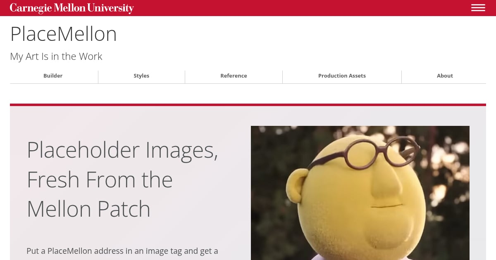

# PlaceMellon

**From Here, Any Dimension Is Possible**

Building a CMU website or app? PlaceMellon gives you placeholder images at
whatever size your layout calls for, from campus photos to Scotty profile
pictures and plain gray boxes.

**[Explore the Documentation](https://placemellon.andrew.cmu.edu/)** ·
[Build a Placeholder](https://placemellon.andrew.cmu.edu/builder.html) ·
[Explore the Options](https://placemellon.andrew.cmu.edu/options.html)

Put a width and height in the URL, such as
`https://placemellon.andrew.cmu.edu/400/300`, and use it wherever you need
an image. Choose a category, make it grayscale or ask for a random photo.
The builder lets you preview the result and copy its URL or HTML.

Inspired by [PlaceCats](https://www.placecats.com/) and
[PlaceBear](https://placebear.com/), with photos from CMU Selects.
Use it for CMU mockups and prototypes; for a finished page, choose and
credit a photo from the source collection.

## Start With What You're Building

- **A page layout:** [Find a photo that fits](https://placemellon.andrew.cmu.edu/builder.html).
- **A people page:** [Explore Scotty and bio placeholders](https://placemellon.andrew.cmu.edu/options.html).
- **A wireframe:** [Try solid placeholders with dimensions](https://placemellon.andrew.cmu.edu/options.html).

The docs cover image formats, sizes and options, plus
[where the photos come from](https://placemellon.andrew.cmu.edu/about.html).

## Help Improve PlaceMellon

[Report a problem or suggest a feature](https://github.com/cmu-web/cmu-web-placemellon/issues),
or read the [contributing guide](CONTRIBUTING.md) to work on the service.
[Development](DEVELOPMENT.md) covers local setup and checks;
[Deployment](DEPLOYMENT.md) explains how to run your own instance.

## License

Copyright Carnegie Mellon University. The code uses the
[BSD 3-Clause License](LICENSE). CMU's names, marks and Scotty artwork,
and the CMU Selects photos, are not covered by that license.

Bunsen Honeydew photo by
[MuppetsStudio](https://commons.wikimedia.org/wiki/File:Dr._Bunsen_Honeydew.png),
[CC BY 3.0](https://creativecommons.org/licenses/by/3.0/), cropped for the docs and preview.
